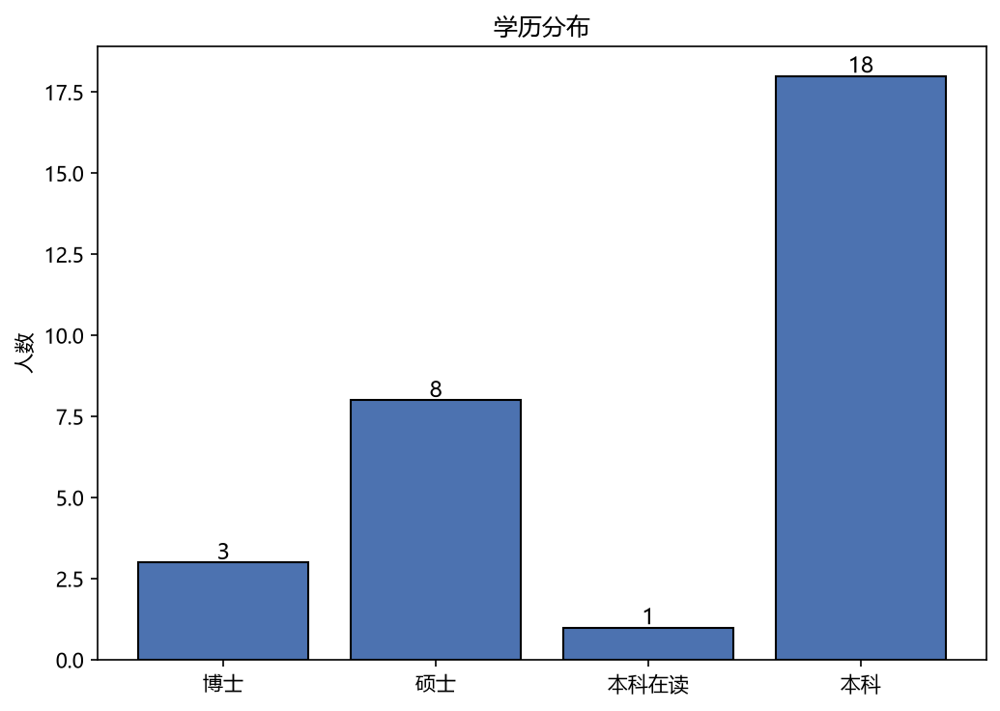
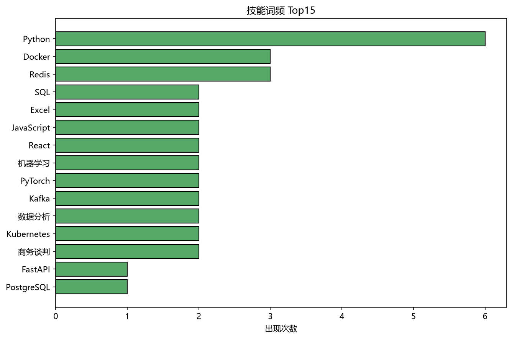
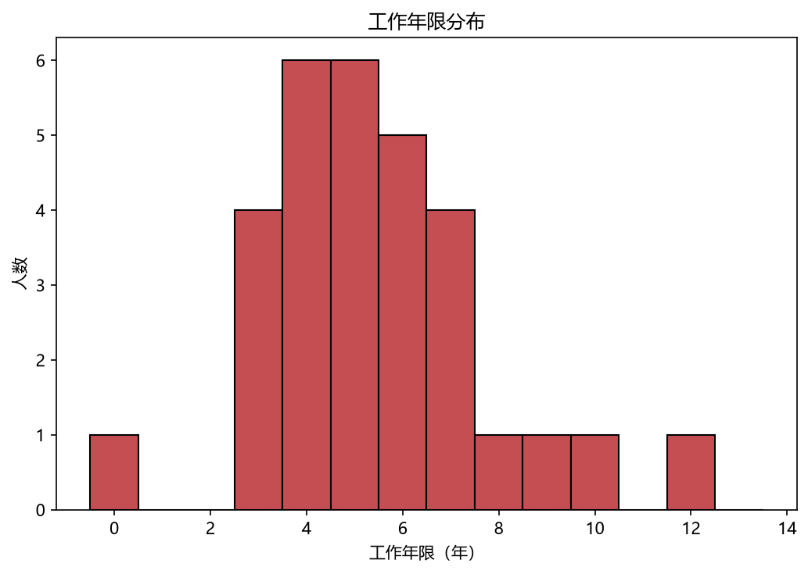
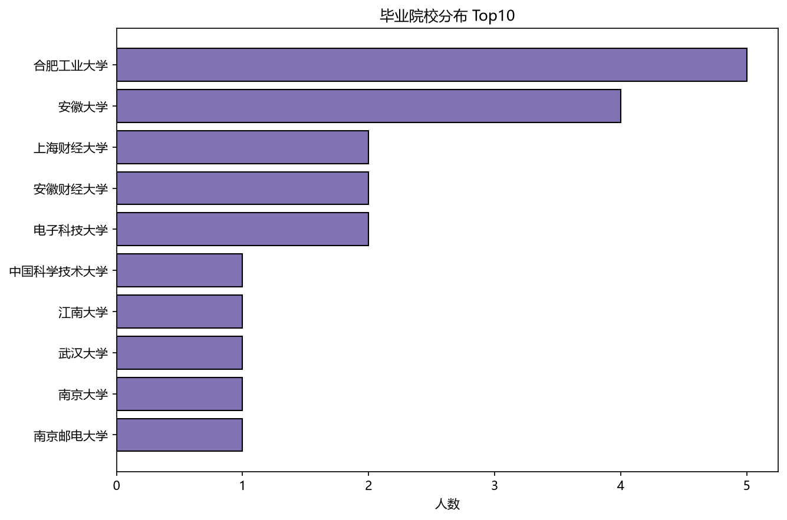

# W7 数据清洗与分析报告

> 数据集：resumes_30.txt（30 份简历原始文本）  
> 清洗脚本：w7_clean.py（核心函数 `clean_resumes(df)`）  
> 核验真值：resumes_30_groundtruth.json  
> 清洗后样本数：**30** 条（去重删除 0 条）

## 一、清洗方法与数据质量

原始文本为半结构化简历，主要脏点包括：电话格式不统一（含短横/无短横）、学历字段与专业/院校混在一行、年限与学历语序多变（如“5年工作经验，本科 …”与“本科 … 5年”）、个别为在读/实习（0 年）。清洗流程：

1. **电话统一**：`phone_clean` 仅保留数字；
2. **学历拆分**：将 `education` 拆为 `degree / major / school` 三列，并重建 `education` 文本；
3. **缺失值**：缺失学校填“未知”，缺失年限用中位数填充（抗异常值）；
4. **异常值**：用 IQR 法标记 `is_outlier`（不删除，资深专家高年限属正常）；
5. **去重**：按 `email` 去重，保留最后一条。

**数据质量发现：**
- 工作年限 IQR 异常值 1 人（林峰），已标记未删除。
- 在读/实习 1 人（董洁），年限记 0，已在报告中如实呈现。

## 二、Ground Truth 字段级核验

匹配样本数：30 / 30  
**整体字段准确率：100.0%**

| 字段 | 正确数 | 准确率 |
| --- | --- | --- |
| 邮箱 | 30/30 | 100.0% |
| 电话 | 30/30 | 100.0% |
| 工作年限 | 30/30 | 100.0% |
| 学历文本 | 30/30 | 100.0% |
| 技能标签 | 30/30 | 100.0% |

## 三、可视化分析与结论

### 图1 学历分布

**结论**：样本以**本科**为主，硕士次之，博士占少数；`本科` 为最主要学历层级，整体呈“本科为主体、硕博为高端补充”的技术人才结构。

### 图2 技能词频 Top15

**结论**：出现频率最高的技能是 **Python**，Python 在数据中跨岗位高频出现，印证“Python 为通用生产力工具”；技能分布呈现明显的工程化（开发/测试/运维）与数据分析双主线。

### 图3 工作年限分布

**结论**：工作年限集中于 **3–7 年**的成熟工程师区间，中位数约 **5 年**；右侧存在 10 年以上资深专家（架构师/项目经理）长尾，属正常业务分布。

### 图4 毕业院校分布 Top10

**结论**：院校分布较为分散，出现次数最多的是 **合肥工业大学**，其中合肥工业大学、安徽大学等出现多次，反映样本在地域/院校上的一定聚集性。

## 四、总结

- 清洗逻辑已封装为 `clean_resumes(df)`，可复用；输出 `resumes_30_clean.csv`。
- 与 ground truth 的字段级整体准确率达 **100.0%**，核心字段（邮箱/电话/年限/学历/技能）均高度一致。
- 数据整体质量较好，主要注意在读/实习年限为 0 与少数资深专家年限偏长两类边界情况，已在报告中如实标注，未做删除。

---
_字体：['Microsoft YaHei']（已验证中文渲染正常）_